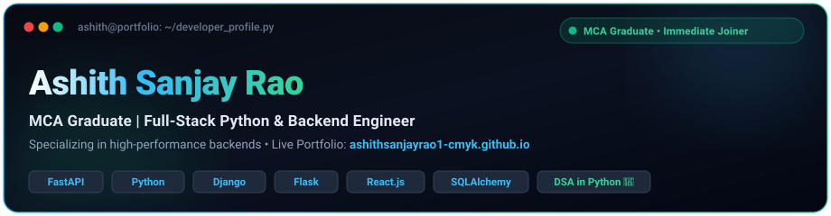

<div align="center">

<!-- 100% RELIABLE REPO-HOSTED VECTOR BANNER (ZERO EXTERNAL SERVICE DOWNTIME) -->


<br/>

<!-- SOCIAL & CONTACT BADGES -->
<p align="center">
  <a href="https://www.linkedin.com/in/ashith-sanjay-rao-b50607303/" target="_blank">
    
  </a>
  &nbsp;
  <a href="https://github.com/ashithsanjayrao1-cmyk">
    
  </a>
  &nbsp;
  <a href="mailto:ashithsanjayrao1@gmail.com">
    
  </a>
  &nbsp;
  
</p>

</div>

---

### 👨‍💻 Executive Summary & About Me

```yaml
Name: Ashith Sanjay Rao
Degree: Master of Computer Applications (MCA Graduate)
Specialization: Full-Stack Python Engineering, Scalable Backends & System Design
Focus: Asynchronous RESTful APIs, Relational Data Modeling, Zero-Trust Security
Problem_Solving: Active Data Structures & Algorithms (DSA) Practitioner in Python
Location: Bengaluru, Karnataka, India 🇮🇳
Availability: Immediate (0-Day Notice Period)
```

- 🎓 **Master of Computer Applications (MCA) Graduate** with strong foundations in computer science, software engineering, and database systems.
- 🚀 **Full-Stack Python & Backend Engineer** experienced in building high-throughput asynchronous web services and production platforms using **FastAPI**, **Django**, **Flask**, and **React.js**.
- 🔐 **Security & System Design Focused**: Experienced in implementing Role-Based Access Control (RBAC), bcrypt cryptographic password hashing, and tamper-proof JSON Web Token (JWT) Bearer authentication.
- 🧮 **Algorithmic Problem Solver**: Actively solving Data Structures & Algorithms problems daily in Python covering Two Pointers, Sliding Window, Binary Search, Linked Lists, Recursion, and Sorting.
- 💼 **Career Objective**: Seeking full-time opportunities as a **Software Development Engineer (SDE)**, **Backend Developer**, or **Python Full-Stack Engineer**.

---

### 🛠️ Technical Stack & Capabilities

<div align="center">

#### 💻 Programming Languages
<p>
  
  
  
  
  
  
</p>

#### ⚡ Backend, APIs & Architecture
<p>
  
  
  
  
  
  
  
  
</p>

#### 🎨 Frontend & UI Engineering
<p>
  
  
  
  
</p>

#### 🗄️ Relational Databases & Storage
<p>
  
  
  
</p>

#### 🔧 DevOps, Cloud & Developer Tooling
<p>
  
  
  
  
  
  
</p>

</div>

---

### 🌟 Featured Projects

| Project | Architectural Overview & Key Technical Capabilities | Technology Stack | Source Code |
| :--- | :--- | :--- | :---: |
| 🌿 **[E-Waste Master ERP](https://github.com/ashithsanjayrao1-cmyk/E-Waste-ERP-Project)** | • **Algorithmic Inventory Engine:** Mathematically validates extraction yields against inbound batch weight to prevent artificial inventory inflation.<br>• **Zero-Trust Security:** Strict Role-Based Access Control (RBAC) isolating Admin, Worker, Driver, and Buyer portals via bcrypt password hashing and JWT Bearer tokens.<br>• **Cryptographic Verification:** In-memory synthesis of landscape Compliance Certificates with SHA-256 digital signatures &amp; QR verification via ReportLab.<br>• **Toxic Element Isolation:** Automatically detects hazardous components (e.g., Lithium-ion batteries) and routes them to specialized manifests.<br>• **Cloud Production Ready:** Configured for Vercel Serverless and Render PaaS with automated SQLite/MySQL environment handling. | `FastAPI`<br>`Python 3`<br>`SQLAlchemy`<br>`Tailwind CSS`<br>`ReportLab`<br>`SQLite / MySQL`<br>`JWT Auth` | [**View Code →**](https://github.com/ashithsanjayrao1-cmyk/E-Waste-ERP-Project) |
| 🎓 **[Automated Examination Workflow (AEW)](https://github.com/ashithsanjayrao1-cmyk/Automated-Exam-Work-Project-AEW-)** | • **Master Timetable Allocation:** Algorithmic examination seating scheduler preventing subject collisions across multi-hall capacity constraints.<br>• **Automated Notification Dispatch:** Automated multi-recipient email engine dispatching personalized HTML hall tickets and faculty invigilation orders via Flask-Mail.<br>• **Multi-Tier User Portals:** Independent authentication portals for Institutional Administrators, Students, and Faculty with USN and email verification.<br>• **Curriculum &amp; Course Mapping:** Dynamic semester and curriculum course mapping with automatic registration audits.<br>• **Vercel Serverless Architecture:** Optimized database initialization handling ephemeral serverless filesystems seamlessly. | `Python 3`<br>`Flask`<br>`Flask-SQLAlchemy`<br>`Flask-Mail`<br>`SQLite`<br>`HTML5 / CSS3`<br>`Werkzeug` | [**View Code →**](https://github.com/ashithsanjayrao1-cmyk/Automated-Exam-Work-Project-AEW-) |
| 🏋️‍♂️ **[Spottr Gym Backend](https://github.com/ashithsanjayrao1-cmyk/Spottr-Project)** | • **High-Throughput Analytics API:** Asynchronous workout logging API engineered for sub-50ms database response on personal record lookups.<br>• **Progressive Overload Tracking:** Automatic computation of total volume load (Sets × Reps × Weight) across multi-week training splits.<br>• **Schema Validation:** Strict payload validation and serialization utilizing Pydantic data models.<br>• **Relational Modeling:** Normalized SQLAlchemy schemas modeling exercise libraries, muscle group classifications, and historical metrics.<br>• **RESTful Standard:** Complete stateless CRUD lifecycle with Swagger UI documentation. | `Python 3`<br>`FastAPI`<br>`SQLAlchemy`<br>`Pydantic`<br>`RESTful APIs`<br>`MySQL / SQLite` | [**View Code →**](https://github.com/ashithsanjayrao1-cmyk/Spottr-Project) |

---

### 🧮 Data Structures & Algorithms (DSA) Mastery

> **Repository:** 🔗 [**ashithsanjayrao1-cmyk / DSA_Interview_Practice**](https://github.com/ashithsanjayrao1-cmyk/DSA_Interview_Practice)  
> Actively solving and implementing optimized algorithmic solutions in Python with asymptotic Time &amp; Space complexity analysis.

| Category / Pattern | Core Algorithmic Techniques &amp; Problems Solved | Language | Solutions Status |
| :--- | :--- | :---: | :---: |
| 🪟 **Sliding Window &amp; Two Pointers** | • Fixed &amp; Variable size sliding window techniques<br>• Opposite-end two pointer traversals (Pair sums, string reversals, palindrome checks)<br>• Container with most water, subarray sum constraints, and window frequency counting | `Python 3` | [**Verified Code →**](https://github.com/ashithsanjayrao1-cmyk/DSA_Interview_Practice/tree/main/slidingWindow%20and%202Pointers) |
| 🔍 **Binary Search** | • Classic binary search on sorted sequences ($O(\log N)$)<br>• Search in rotated sorted arrays<br>• Finding first and last position of element<br>• Peak element discovery and search space reduction patterns | `Python 3` | [**Verified Code →**](https://github.com/ashithsanjayrao1-cmyk/DSA_Interview_Practice/tree/main/Binary_search) |
| 🔗 **Linked Lists** | • Singly linked list creation, traversal, and node insertion/deletion<br>• In-place linked list reversal<br>• Floyd’s Cycle Detection algorithm (Fast &amp; Slow pointers)<br>• Merging two sorted linked lists | `Python 3` | [**Verified Code →**](https://github.com/ashithsanjayrao1-cmyk/DSA_Interview_Practice/tree/main/LinkedList) |
| ⚡ **Sorting Algorithms** | • **Merge Sort:** Divide-and-conquer recursive partitioning with $O(N \log N)$ guarantee<br>• **Quick Sort:** In-place pivot selection and array partitioning<br>• **Comparison Sorts:** Bubble Sort, Selection Sort, and Insertion Sort implemented from scratch | `Python 3` | [**Verified Code →**](https://github.com/ashithsanjayrao1-cmyk/DSA_Interview_Practice) |
| 🔁 **Recursion &amp; Backtracking** | • Base case formulation and recursive stack tracing<br>• Subsets, string combinations, and permutation generation<br>• Divide-and-conquer problem decomposition and factorial/fibonacci memoization | `Python 3` | [**Verified Code →**](https://github.com/ashithsanjayrao1-cmyk/DSA_Interview_Practice/tree/main/Recursion) |
| 🔢 **Mathematical &amp; Number Theory** | • Primality testing &amp; sieve techniques<br>• Euclidean GCD &amp; LCM algorithms<br>• Digit manipulation, Armstrong number verification, palindrome numbers, and divisor factorizations | `Python 3` | [**Verified Code →**](https://github.com/ashithsanjayrao1-cmyk/DSA_Interview_Practice) |

---

### 📬 Connect & Collaborate

<p align="center">
  I am actively interviewing and open to full-time <strong>Software Engineer (SDE)</strong>, <strong>Backend Developer</strong>, and <strong>Full-Stack Python</strong> positions.
</p>

<p align="center">
  <a href="https://www.linkedin.com/in/ashith-sanjay-rao-b50607303/" target="_blank">
    
  </a>
  &nbsp;&nbsp;
  <a href="https://github.com/ashithsanjayrao1-cmyk">
    
  </a>
  &nbsp;&nbsp;
  <a href="mailto:ashithsanjayrao1@gmail.com">
    
  </a>
</p>

<div align="center">
  <sub>© 2026 Ashith Sanjay Rao • Engineered for performance, security, and scalability.</sub>
</div>
